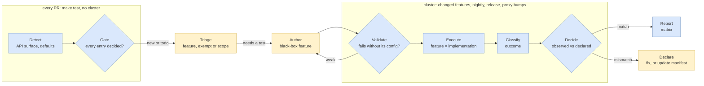

# Proxy-Agnostic Istio: Conformance, Visibility, Convergence

Status: Draft / Proposal
Branch: `proxy-conformance`

## TL;DR

Istio was designed around Envoy as its data plane proxy, and that relationship is deeply embedded in
how istiod operates today. With the introduction of ztunnel, we reached a first inflection point
where Envoy was no longer the only supported data plane. That already introduced structural issues
around feature parity and our ability to track and maintain consistent behavior across proxies. Now,
with the addition of agentgateway, we are stretching our existing code base even further by
duplicating config generation logic to work with the respective agentgateway abstractions. This
document proposes a structured approach to dealing with the challenges of three supported proxies,
and ultimately aims to set up the Istio project to more easily adopt new proxies in the future, with
less toil and more confidence for maintainers and users that existing behaviors are preserved.

## 1. Problem

### 1.1 Where we are

Istio ships three data plane proxies across five roles:

| Role                 | Implementations today      |
|----------------------|----------------------------|
| Sidecar              | Envoy                      |
| Waypoint (L7)        | Envoy, agentgateway (experimental, `istio-agentgateway-waypoint`) |
| Node / L4 (ambient)  | ztunnel                    |
| Ingress gateway      | Envoy (`istio` class), agentgateway (`istio-agentgateway` class) |
| Egress gateway       | Envoy                      |

istiod generates config for them through separate pipelines:

- **Envoy:** Gateway API is first converted to Istio APIs (`pilot/pkg/config/kube/gateway`, about 7k
  lines of non-test code). About 23k lines in `pilot/pkg/networking` plus 2.8k in
  `pilot/pkg/security/authz` then lower `VirtualService`, `DestinationRule`, `AuthorizationPolicy`,
  `Sidecar`, `Telemetry` and `EnvoyFilter` into Envoy xDS. The Istio APIs are, in effect, the
  intermediate format for Envoy, with Envoy semantics baked in.
- **ztunnel:** the workload API (WDS), a proxy-neutral wire format.
- **agentgateway:** `pilot/pkg/config/kube/agentgateway` (about 6.9k lines) translates Gateway API
  directly into the agentgateway API. It duplicates the Gateway API translation the Envoy path
  already has, and it reads none of the Istio policy APIs.

### 1.2 What breaks

- **No source of truth for parity.** Nobody can say which Istio features work on which proxy in which
  role. Feature tests are spread across about 5k lines of `tests/integration/pilot/common/routing.go`,
  `tests/integration/ambient/*` and Gateway API conformance runs, and many assertions read Envoy
  internals (e.g. `hasHTTP2Keepalive` parses an Envoy config dump), so they can't run against another
  proxy.
- **Unsupported config is silently ignored.** istiod accepts config that the target proxy never
  receives. The PoC (§4) measured the worst case: an `AuthorizationPolicy` DENY bound to an
  agentgateway gateway is accepted with no status signal and **not enforced**; traffic passes.
- **Drift is structural.** Every feature added to one pipeline has to be added to the others by hand,
  and nothing fails when that doesn't happen.
- **New proxies are expensive.** Adding a proxy today means another translation pipeline and another
  set of Envoy-coupled tests, with no way to know when it is "done".

## 2. Approach

Three steps, each useful on its own and each a prerequisite for the next:

| Step | What | Answers |
|---|---|---|
| **1. Measure** | A black-box, implementation-neutral **Proxy Conformance Suite (PCS)**, plus a deterministic **coverage check** on every PR (§3) | Which features work where? Is new behavior tested? |
| **2. Make gaps visible** | A **capability and status layer** in istiod: config a proxy can't honor is reported, and security config fails closed (§5) | Do users learn that their config does nothing? |
| **3. Converge** | A **shared intermediate representation** in istiod that every proxy lowers from (§6) | Can parity hold by construction instead of by effort? |

Step 1 produces the data that justifies steps 2 and 3, and it is the safety net that makes step 3 a
refactor rather than a rewrite.

**Goals**
1. A definitive, machine-checkable answer to "does feature X work on proxy Y in role Z".
2. No silent failures: unsupported config is visible, and unsupported *security* config fails closed.
3. Behavior is preserved: changes to istiod, Istio APIs or a proxy cannot silently change or drop
   tested behavior.
4. Adding a proxy is a bounded, checkable amount of work (§7).
5. Reuse the existing test framework (`pkg/test/framework`, echo, `check`).

**Non-goals**
- Performance comparison between proxies (a separate benchmark suite could reuse the harness).
- Making Envoy-only extension APIs (`EnvoyFilter`, `WasmPlugin`, Lua/Wasm `TrafficExtension`) portable.
  They are catalogued as `impl-specific` so the matrix shows what is lost by switching, but they are
  not conformance requirements.
- Replacing upstream Gateway API conformance; PCS runs it per proxy instead (§3.3).

## 3. Step 1: Measure

PCS is a pipeline from "what can a user configure" to "what does each proxy do with it", in four
stages:

| Stage | What | Who |
|---|---|---|
| **Sources** | Where proxy behavior is defined: istio/api protos, the annotation and label registries, istiod feature flags, the Gateway API extension registry in istiod, defaults istiod generates, and a reviewed inventory of interactions | code; interactions reviewed by hand |
| **Surface** | One entry per field, enum value, annotation, label, flag, extension or interaction, with its source and its decision (covered, exempt, out of a role's scope, `todo`) | code computes; human or LLM decides |
| **Tests** | Black-box features, each listing its roles and the surface entries it covers | human or LLM writes; code validates |
| **Report** | Every feature against every implementation of its roles, classified and compared with the declared support | code; a human accepts changed results |

Most of it is deterministic code. Humans, or LLMs under human review, are needed in three places:
deciding what a surface entry means (triage), writing the test (author), and accepting a changed
result (declare). In more detail:



Blue stages are code; yellow stages need a human, or an LLM whose output a human reviews.

| Stage | Who | What | How |
|---|---|---|---|
| Detect | code | Compute what users can configure and what istiod configures by default | Protobuf reflection over the kinds istiod watches, the istio/api annotation and label registries, the Gateway API extension registry in istiod, an import-graph scan for feature flags, xDS from a fake istiod; plus one reviewed inventory, interactions (§3.5) |
| Gate | code | Fail the PR when an entry has no decision, a decision is stale, or a ratchet would rise; require a `# pcs:` decision for changed proxy-area release notes and translator goldens | `TestCoverage` and its companion tests, in `make test` (§3.5) |
| Triage | human or LLM | Decide each new entry: a feature covers it, exempt with a reason, out of a role's scope, or `todo` for later | `pcs worklist`; `exemptions.yaml`, `scope.yaml`, `interactions.yaml`, `defaults-inventory.yaml`, `releasenote-backlog.yaml` |
| Author | human or LLM | Write a black-box feature against `Scenario`/`Target`, with `Covers` and `Roles` | `pcs scaffold`; `features_<area>_test.go` (§3.1, §3.2) |
| Validate | code | The feature passes on the reference and fails with its config stripped | Negative controls (§3.4); `pcs changed` selects them |
| Execute | code | Run every feature against every implementation of its roles, reproducibly | Witnesses, derived statistics, two-sided timing (§3.6) |
| Classify | code | Turn a failure into an outcome; reject a pass that never set what it claims to cover | Rerun, per-proxy control, status conditions, `Covers` evidence (§3.7) |
| Decide | code | Compare observed with declared: pass, known gap, regression or improvement | `outcome.Decide` (§3.7) |
| Declare | human | Fix a regression, or accept the result and review the manifest diff | `-istio.test.pcs.update-declared` (§3.7) |
| Report | code | Per-role reports, per surface entry, and the published matrix | `pcs-report-<role>.yaml`, `pcs report` (§3.7) |

Detect and Gate run on every PR without a cluster; Validate through Decide need a cluster and run on
a schedule, and for changed features per PR (§3.11). The code stages are also what makes LLM help
safe: a triage decision is a reviewed line in a checked-in file, a drafted feature is checked by its
negative control on the reference, and a declaration is held to the measured result on every run. No
stage checks that a test observes the behavior its description and `Covers` claim; human review
concentrates there (§3.11).

### 3.1 Model

```text
Feature  ×  Proxy(implementation, role)  →  result
```

- **Proxy:** an implementation in a role, e.g. `envoy` and `agentgateway` as gateways. Role and
  implementation are separate axes throughout (the production model mixes them; see §9.1).
- **Feature:** one externally observable behavior, with a stable hierarchical ID
  (`security.authz.deny.path`), a description, the roles it applies to, and the API surface it
  `Covers` (used by the coverage check, §3.5). A feature is written once against a `Scenario`
  abstraction that hides everything implementation-specific: how a gateway is deployed, how policy
  attaches (`targetRefs` or the standard `gateway.networking.k8s.io/gateway-name` label), how
  traffic is sent.
- **Result:** pass or fail per (proxy, feature). Subtests are named `<proxy>/<feature-id>`. The suite
  is expected to be red for implementations that are not feature-complete; that red is the data.

### 3.2 Black-box rules

Assertions may only use the echo backend's view of the request (status, headers, path, protocol,
SNI, which backend version answered), Kubernetes status, the proxy's standard telemetry
(`:15020/stats/prometheus`, access logs), and timing. Config dumps, admin endpoints and `istioctl
proxy-config` are not allowed. If a behavior can only be seen that way, either echo is improved or
the behavior is not conformance-relevant.

The PoC added rules that are easy to get wrong:

- **Observe at an out-of-mesh backend when the header or protocol matters.** An in-mesh backend's
  sidecar rewrites `X-Forwarded-Client-Cert`, adds `X-Request-Id`, and re-encodes HTTP/2 to the app.
  A test that observes behind a sidecar measures the sidecar, not the proxy under test.
- **Keep the effect at the proxy under test.** Namespace-wide and mesh-wide policies also apply to an
  in-mesh backend's sidecar, which then enforces them instead.
- **Avoid paths that hide the client.** A LoadBalancer path SNATs the client address; client-IP
  features call the gateway pod directly.
- **Test product defaults, not test-environment defaults.** `tests/integration/base.yaml` disables
  retries mesh-wide for all integration tests; PCS restores Istio's built-in default.

### 3.3 Scope

PCS covers **Istio-specific** behavior only:

- Istio APIs on the proxy: AuthorizationPolicy, RequestAuthentication, PeerAuthentication,
  DestinationRule, ServiceEntry, Telemetry, Istio Gateway/VirtualService, ProxyConfig.
- Istio extensions of Gateway API: annotations, listener `tls.options`, `Hostname` backendRefs,
  parametersRef overlays, manual deployment, the deployment controller.
- Istio data plane defaults: XFF/XFCC handling, request IDs, retries, metrics, access logs.

Plain Gateway API semantics are covered by upstream conformance, which `TestGatewayAPIConformance`
runs against every ingress implementation with **all** gateway features enabled, so a failing upstream
test means "not supported by that proxy" rather than "not claimed". The mesh (GAMMA) profile is not
run per sidecar or waypoint implementation yet (§3.11).

### 3.4 Test validity: negative controls

A test is only valid if it passes on the reference implementation **and fails when the feature is
missing**. The PoC found tests that passed on agentgateway while it ignored the feature entirely, e.g.
because a backend sidecar enforced the policy, or because "header disabled" passes trivially for a
proxy that never sets the header.

`TestIngressConformanceControls` (ingress), `TestEgressConformanceControls` (egress),
`TestSidecarConformanceControls` and `TestWaypointConformanceControls` check this systematically. Each feature runs against the role's
reference implementation with its config under test removed: Istio policy and routing objects
(including `Sidecar` resources) and ConfigMaps are stripped from what the feature applies, as are the
gateway's annotations, labels, `infrastructure`, `addresses` and `tls`, and the feature's MeshConfig
patch and istiod environment. Scaffolding (routes, Services, ServiceEntries, Istio Gateways, Secrets,
and the per-feature `DestinationRule` that disables connection reuse towards a waypoint) stays. If every assertion
still passes, the test is **weak** and the control fails. Features with nothing to strip are not
applicable; features with no client-visible effect (e.g. AUDIT) declare `NoControl` with the reason.

### 3.5 Keeping it current: the coverage check

`tests/conformance/proxy/coverage/` is a plain unit test (no cluster, no build tag), so it
runs in `make test` on every PR. It computes the **API surface** the suite must cover from these
sources:

- every field and enum value of every Istio config kind istiod watches (`collections.Pilot`), by
  protobuf reflection, so a new CRD is tracked without anyone listing it. Kinds without proxy behavior
  are exempted as a whole with a reason; EnvoyFilter is tracked but exempted (raw Envoy patches,
  impl-specific features), and WasmPlugin is regular surface (its API has no Envoy-isms);
- `MeshConfig` and `ProxyConfig` in full, with sidecar-only and istiod-internal subtrees exempted by
  prefix with a reason;
- Istio annotations and labels from the istio/api registries that apply to Pod, Namespace, Service,
  ServiceEntry, Gateway or WorkloadEntry (installation and bookkeeping keys exempted with a reason);
- Istio's Gateway API extensions (annotations, listener `tls.options` keys, parametersRef overlays,
  `Hostname` backendRefs, ...) from `gatewayext.Registry()` in `pilot/pkg/config/kube/gatewayext`,
  next to the translators that implement them;
- every istiod feature flag (`pilot/pkg/features`) referenced from code that generates proxy config:
  the Gateway API translators, `pilot/pkg/networking/...`, `pilot/pkg/model`, `pilot/pkg/xds/...`,
  `pilot/pkg/security/...`, the ambient workload API in `pilot/pkg/serviceregistry/ambient`, and every
  istio.io package they import, transitively. Control-plane-only flags (debouncing, caches, debug
  endpoints) are exempted;
- multi-resource semantics that are not single fields, from the reviewed inventory
  `coverage/data/interactions.yaml` (`interaction:<id>`: authz evaluation order, policy scope precedence,
  DestinationRule merging, VirtualService delegation, exportTo, protocol selection, ...). Each entry
  names its roles (an implicit `roleScope`) and a source; features cover it through `Covers`, or the
  entry lists existing features in `coveredBy`.

Subtrees that repeat a type tracked elsewhere (`DestinationRule.subsets.trafficPolicy`,
`portLevelSettings`, `MeshConfig.defaultTrafficPolicy`) collapse to one entry, since only their
precedence semantics need their own test.

The computed surface is generated into `coverage/data/surface.yaml` and checked for freshness, so every
surface change (an istio/api bump, a new flag on a proxy code path) is visible in review. It maps each
entry to its source (`proto`, `annotation-registry`, `label-registry`, `extension-registry`,
`feature-flags`, or `manual` for the interactions inventory, the only hand-maintained source) and
nothing else, so it changes only with the API. Flags are qualified by the component that reads them
(`flag:<component>:<ENV>`: `istiod`, `agent`, `cni`, `iptables`). The resolution against features and
decisions is generated into `coverage/data/coverage.yaml`: each entry's status (`covered`, `exempt` or
`todo`), the features covering it per role, and the roles in whose scope it is a gap, including entries
under a prefix exemption. The numbers (entries by source and status, features
and gaps per role, ratchets) are generated into `coverage/data/summary.yaml`; documents refer to it rather
than copying them.

The decisions about the surface are checked in, one file per concern: `exemptions.yaml` (surface
deliberately not covered, each with a real reason), `scope.yaml` (which roles must cover what, below)
and `ratchets.yaml` (the bounds below). Each surface entry must be covered by a feature's `Covers`
list or exempted; the rest is the `todo` backlog, which is derived, not listed. The check fails when:

- new surface appears (a field added in istio/api, a new annotation, a new flag on a proxy code path)
  and pushes the backlog over `maxTodo`;
- a `Covers` entry doesn't exist (typo, removed field);
- an exemption is stale or redundant;
- a ratchet would rise. `maxTodo` and `maxRoleGaps` only go down (`-update` lowers them);
  deliberately widening the surface requires `-raise-todo`, which shows up in review.

A companion test, `TestExtensionKeysTracked`, scans the Gateway API translators for `*.istio.io/...`
string keys, so a new annotation or `tls.options` key in istiod cannot be added without a registry
entry.

Every feature must name the roles it applies to. The check parses `Roles` (the `Role` constants and
aliases such as `ingressRole`), fails when a feature lists none or an unknown role, and fails when a
declared role has no features at all. This puts the requirement in `make test`, not only in the
integration runner's registration panic. Features live in `features_<area>_test.go` by the first
segment of their ID (`TestFeatureFiles`), so the feature for an area is found in one place.

`TestReleaseNotesTracked` uses release notes as Istio's own declaration that a change is user-facing.
Every changed note in a proxy area (`traffic-management`, `security`, `networking`, `network`,
`telemetry`, `extensibility`, `EnvoyFilter`, `pilot`) records the coverage decision in the note
itself:

```yaml
# pcs: feature <feature-id>        this PR adds that conformance feature
# pcs: covered-by <feature-id>     the behavior is already covered by that feature
# pcs: not-proxy-behavior: <why>   the change cannot affect a proxy (reason required)
```

The check validates that the referenced feature exists and that `not-proxy-behavior` gives a reason.
The decision is reviewable where the claim is made, cannot be satisfied by unrelated file churn, and
is not demanded for notes the PR does not touch. The base commit is
`PULL_BASE_SHA`/`GITHUB_BASE_SHA`, else the closest merge base with `master` or `origin/master`;
without git the check skips. Notes outside the proxy areas (installation, istioctl, documentation)
are not gated, so a proxy-behavior change filed in one of those areas would be missed.

Notes that predate the gate are triaged in `coverage/data/releasenote-backlog.yaml`
(`TestReleaseNoteBacklog`, no git needed): every proxy-area note must carry a `# pcs:` decision or
have a backlog entry with one (or `todo`, ratcheted by `maxBacklogTodo`). `-update` pre-classifies
only notes of a test/docs kind or whose text matches only control-plane topics (istioctl, Helm
values, installation) and none of a broad list of proxy terms; everything else starts as `todo`.

**Per-role coverage.** The global check counts an entry as covered when any role covers it, so a new
role could stay almost empty without moving the ratchet (the egress role's first two features only
registered `Gateway.servers.port.number`, the rest was already covered by ingress). `scope.yaml`
therefore assigns surface subtrees to the roles that must cover them themselves (longest prefix wins;
e.g. sidecar and waypoint get AuthorizationPolicy, RequestAuthentication, DestinationRule,
`VirtualService.http`, Telemetry, ServiceEntry; node gets PeerAuthentication and the L4
AuthorizationPolicy fields; egress gets ServiceEntry, `DestinationRule.trafficPolicy.tls`, Istio Gateway
servers and `VirtualService.tls`/`tcp`). Entries no key matches belong to the `default` roles
(ingress), and mesh-only subtrees such as `Sidecar` leave ingress out, so ingress has a scope and an
end of its own. `maxRoleGaps` ratchets the uncovered in-scope entries per role.
Entries exempted with a real reason are out of scope for every role. Keys ending in `*` match by
plain prefix (`annotation:sidecar.istio.io/*`). Behavior that is not an API field is tracked in
`coverage/data/interactions.yaml`; the use-case inventories, like `architecture/tests/egress-use-cases.md`,
remain the source for role-specific scenarios.

**Translator goldens.** Release notes are voluntary. The Gateway API translator test data
(`pilot/pkg/config/kube/{gateway,gatewaycommon,ingress}/testdata`) is deterministic evidence that
proxy-facing output changed, so `TestTranslatorGoldensTracked` requires a PR that changes it to carry a
coverage decision: a changed proxy-area release note with a `# pcs:` line, or the same decision as a
commit message line (`pcs: covered-by <id>`, ...). It complements the release-note gate; it does not
see changes to xDS generation, which has no goldens.

**Defaults inventory.** The surface lists what users can configure, but much of what a proxy does
comes from what istiod configures when they configure nothing (XFF handling, retries, timeouts,
stats, access-log format). `TestDefaultsInventory` (`coverage/defaults/`) generates the xDS a fake
istiod sends to a sidecar, a router, a waypoint and ztunnel in a minimal mesh, and normalizes it to
value-free paths (`<proxy>/<resource>/<field>/...`; list indexes, values and per-service names
dropped). Every path needs a decision in `defaults-inventory.yaml`: `feature <id>` (a feature that
tests that proxy type observes it), `exempt: <reason>` (not observable black-box, naming,
bookkeeping) or `todo`, ratcheted by its own `maxTodo`. A default istiod starts to set fails the
check until someone decides about it. The values of the decided paths (numbers, booleans, enums,
durations; not names) are generated into `defaults-values.yaml`, so a changed default value (a
timeout, a header policy) also fails until the features observing it are reviewed and the file is
regenerated.

### 3.6 Detecting behavior deterministically

A result is only data if rerunning the suite gives the same answer. The PoC had three sources of
nondeterminism, each now handled structurally rather than per test.

**Propagation witnesses instead of sleeps.** Config reaches the proxy asynchronously. A positive check
("returns 403") synchronizes itself: `Expect` retries until it holds. A negative check ("no access log
line", "counter did not increase") holds trivially before the config arrives, so the PoC slept 10s and
hoped. Negative checks now come after a *witness*: a positive, observable effect carried by the same
config object, which the proxy receives in the same push. For Telemetry, which has no client-visible
effect, the witness is a `tagOverrides` label `pcs_witness=<nonce>` added to
`istio_request_duration_milliseconds` in the same object (`WitnessMetricsOverride`,
`Gateway.WitnessTelemetry`). Ordering gives exact absence checks where a positive exists in the same
stream: `telemetry.accesslog.filter` sends the unlogged request first and the logged one second, so once
the second is logged, the first would have been. Where no positive exists, absence is concluded after a
documented latency bound (`logFlushBound`, Envoy's file flush interval plus margin), and only for traffic
sent after the witness. Features may not call `time.Sleep`; the coverage check enforces it.
`ExpectStable` remains valid for negatives whose baseline is the opposite (the header is present without
the config), which the negative controls verify.

**Statistics derived, not picked.** Weighted routing and fault percentages are probabilistic. A
hand-picked `+/- 12` on 100 requests is a ~3σ bound, a false failure every ~370 runs, multiplied by
hundreds of (proxy, feature) pairs. `outcome.CheckShare` derives the tolerance from the sample size and
a false-failure rate of 1e-6 per share (z = 4.89), and `SampleSize` picks the request count that keeps the
tolerance within 10 points; a check with too few samples fails as such. Deterministic designs (0/100
then 100/0, header steering) are preferred where the behavior allows.

**Timing is two-sided.** A delay feature also times a control route of the same object in the same
attempt: the delayed route must exceed the delay and the control must stay well below it, so a slow
environment cannot pass the lower bound with no delay configured.

### 3.7 Outcomes and declared support

The harness, not the feature author, classifies results. A feature's `Run` stays imperative, but it runs
against a recorder instead of the real test, so a failed assertion becomes evidence rather than a
verdict (`classify_test.go`, logic in the cluster-free `outcome/` package):

| Outcome | Meaning | Detected by |
|---|---|---|
| `supported` | All behavioral checks pass. | |
| `partial` | Some subcases pass, e.g. methods yes, `when` headers no. | `Scenario.Case` results |
| `rejected` | Config visibly refused. | Admission error, or a False `Accepted`/`ResolvedRefs`/`Programmed`/`Reconciled` condition (incl. route `parents` and policy `ancestors`) on an applied object, read before cleanup |
| `fail-closed` | Accepted silently, traffic denied (security features only). | The failing call was answered 401/403 or reset |
| `ignored` | Accepted, no status, behavior unchanged. | A negative control on the *same* proxy (config removed) fails at the same assertion (file:line) with the same answer (`failedWith`, e.g. `codes=404`) |
| `fail` | Wrong behavior of another kind. | Otherwise |
| `indeterminate` | Propagation could not be established (witness never appeared). Not a result. | `Scenario.Indeterminate` |
| `flaky` | Failed, then passed on rerun. Not a result; the test must be fixed. | Rerun |

A failed feature therefore costs up to two more runs (rerun, control), each in its own subtest
(`<proxy>/<feature>/{run,rerun,control}`) so resources are cleaned up between them;
`-istio.test.pcs.classify=false` skips both. The per-proxy control also makes "Ignored" a runtime
measurement for every implementation, where the negative controls (§3.4) only validate tests against
the reference. Matching the answer, not only the line, keeps a shared helper or loop from matching by
accident: a proxy that answers 503 where the control got 404 did something with the config.

Security features are those with a `security.` ID or whose `Covers` include AuthorizationPolicy,
RequestAuthentication, PeerAuthentication or a security interaction (`coverage.IsSecurity`), so a
mesh or egress feature about authorization is held to the fail-closed rule too.

**Covers evidence.** A passing run that never set a key it lists in `Covers`, in any config it applied
of that key's kind, fails: a claim the run did not exercise would count as coverage without evidence.
Kinds the feature did not apply (set on a shared gateway or through MeshConfig) and ProxyConfig (also
set through MeshConfig and annotations) are not checked.

**Declared support.** Each (role, implementation) has a checked-in manifest,
`declared/<role>/<impl>.yaml`, one of which per role is the reference. Every feature of the role has an
entry: a status (an outcome, `unsupported` for any gap, or `unknown`), a reason for gaps, optionally an
issue, and the passing cases for `partial`. The harness compares observed with
declared (`outcome.Decide`):

- matches a declared `supported`: pass;
- matches a declared gap: the subtest is **skipped** as a known gap, so the suite is green for an
  implementation that is exactly as conformant as it claims, and CI can gate on it;
- worse than declared (outcomes are ranked supported > partial > rejected > fail-closed > fail >
  ignored), or a declared passing case now fails: **regression**, fails;
- better than declared: fails until the manifest is updated, so declarations cannot rot;
- `flaky`, `indeterminate`, or an ignored security feature not declared `ignored` (fail-open must be
  explicit, not hidden behind `unsupported`): fails regardless of the declaration;
- `unknown`: skipped and reported. `unknown` entries are ratcheted (`maxUnknown`), and the reference
  manifest cannot gain new ones, so every new feature is declared against the reference when it is added.

`-istio.test.pcs.update-declared` rewrites the manifests from a run (keeping reasons and issues of
unchanged entries) for review. The cluster-free `TestDeclaredSupport` checks that every manifest is
complete, has no stale entries, and has reasons where required.

**Reports.** Every run writes `pcs-report-<role>.yaml` (`$ARTIFACTS` by default), modeled on the Gateway
API `ConformanceReport`: per implementation, a per-profile outcome summary and per feature the outcome,
reason, failed assertion and answer, cases, declaration, decision, attempts and duration.
`TestGatewayAPIConformance` writes the upstream suite's report per implementation
(`gateway-api-report-<impl>.yaml`) next to it. `pcs report` joins the surface with the declarations,
or with the reports of a run: one row per surface entry and role, with the features covering it and
each implementation's worst result, which is the view the istio.io matrix needs. Reports are CI
artifacts, not checked in per PR; per release they are published under `reports/<istio-version>/` and
render the istio.io matrix, keyed by feature ID with `/case` suffixes and mapped to API fields through
`Covers`.

**Profiles.** Features belong to `core` (default), `extended`, or `impl-specific` (default for
`impl-specific.*` IDs), so "agentgateway supports waypoint core" is one checkable claim.

**Catalog.** `coverage/data/catalog.yaml` is generated from the feature definitions (`TestCoverage -update`) and
checked for freshness, so documentation and tooling read feature metadata without parsing Go. Renamed
features keep their former IDs in `Aliases`.

### 3.8 Layout and running

```text
tests/conformance/proxy/
  main_test.go                 # TestMain: Istio with ambient (ztunnel+CNI) and agentgateway; defaults
  harness_test.go, kube_test.go, checks_test.go, certs_test.go, env_test.go
  proxies_test.go              # proxy list per role; --istio.test.pcs.proxies=envoy,agentgateway
  roles_test.go                # Test<Role>Conformance: proxy × feature, one test per role (§3.9)
  gateway_test.go              # TestIngressConformance (ingress gateways), TestEgressConformance
  workload_test.go             # mesh target: meshed client, per-feature backend, waypoint attachment
  target_test.go               # role-neutral Target: traffic, routing and policy attachment per role
  meshwide_test.go             # Feature.MeshConfig / IstiodEnv: serial phase per proxy, istiod restarts
  controls_test.go             # negative controls (§3.4), one test per role except node
  classify_test.go             # outcome classification, declared-vs-observed, reports (§3.7)
  witness_test.go              # propagation witnesses and bounded absence checks (§3.6)
  outcome/                     # cluster-free: outcome taxonomy, Decide, statistics, report schema
  declared/<role>/<impl>.yaml  # declared support manifests (§3.7)
  gatewayapi_test.go           # TestGatewayAPIConformance: upstream suite per proxy, all features
  features_<area>_test.go      # features by area (first ID segment; TestFeatureFiles)
  coverage/                    # coverage check (§3.5), runs in unit tests
  coverage/defaults/           # defaults inventory and values (§3.5)
  coverage/data/               # the coverage check's checked-in data
    catalog.yaml               #   generated feature catalog
    surface.yaml               #   generated: the surface, entry -> source
    coverage.yaml, summary.yaml #  generated: the surface resolved against features and decisions, its numbers
    exemptions.yaml, scope.yaml, ratchets.yaml, interactions.yaml, releasenote-backlog.yaml
    defaults/                  #   defaults inventory and generated values
  cmd/pcs/                     # worklist, scaffold, changed, report, backlog
```

```sh
# one role, all implementations
go test -tags=integ -run TestIngressConformance ./tests/conformance/proxy/
go test -tags=integ -run TestEgressConformance ./tests/conformance/proxy/
go test -tags=integ -run TestWaypointConformance ./tests/conformance/proxy/
go test -tags=integ -run TestNodeConformance ./tests/conformance/proxy/
go test -tags=integ -run TestSidecarConformance ./tests/conformance/proxy/

# cluster-free checks and generated files
make pcs-check
make pcs-update

# tooling: make pcs.<command> PCS_ARGS="..."
make pcs.worklist PCS_ARGS="-role sidecar -prefix DestinationRule"   # gaps with their documentation
make pcs.scaffold PCS_ARGS="DestinationRule.trafficPolicy.tls.sni"     # a Feature skeleton
make pcs.changed                                                       # -run expressions for changed features and controls
make pcs.report PCS_ARGS="-role ingress -reports $ARTIFACTS"           # per surface entry and implementation
make pcs.backlog PCS_ARGS="-from 1.28.0"                               # untriaged release notes since a release
```

### 3.9 Beyond gateways

Every legitimate proxy role is its own conformance test and its own row of the matrix:

| Role | Topology | Policy attachment |
|---|---|---|
| ingress gateway | client(out-of-mesh) → gateway → backend | `targetRefs`, `gateway-name` label |
| sidecar | client(sidecar) → server(sidecar) | `selector` |
| node (ztunnel) | client(ambient) → server(ambient), **L4 only** | `selector` |
| waypoint | client(ambient) → ztunnel → waypoint → server | `targetRefs` Gateway/Service |
| egress gateway | client(sidecar) → egress gateway → external | `selector` (`istio=egressgateway`) |

Ingress and egress are separate roles even though both are gateways: ingress is a Gateway API
gateway (one `GatewayClass` per implementation), while egress is an istio-proxy deployment the mesh
routes to through Istio API config (a `Gateway` with `selector: istio: egressgateway`, a
`VirtualService` attached to `[mesh, <gateway>]`, and a `ServiceEntry` for the external host).
Implementations differ: agentgateway implements ingress but not the egress gateway. An egress
feature routes its own external host, so features can share one egress gateway without interfering;
it proves the request traversed the gateway with a header the gateway's route leg adds (the negative
control strips the `VirtualService`, so traffic leaves the mesh directly and the header is absent).
The use cases the egress role must cover are inventoried in `architecture/tests/egress-use-cases.md`.

**Role-neutral features.** Most Istio API features mean the same thing on every L7 proxy, so they are
written once against a `Target` and tagged with every such role (`l7Roles`: ingress, sidecar,
waypoint). The Target hides the per-role differences: where traffic enters (gateway address, or the
feature's backend Service intercepted by the client-side proxy), how "this feature's host" is routed
(VirtualService bound to an Istio Gateway or an HTTPRoute on ingress; a mesh VirtualService or an
HTTPRoute with a Service parentRef otherwise), and how policy attaches, following Istio's rules:
`targetRefs` Gateway on ingress, a `selector` on the server workload for sidecars (server-side policy
is enforced by the server's inbound proxy) and the node proxy, `targetRefs` Service for waypoints
(selector policies never bind to a waypoint; ztunnel would enforce them at L4). Features stay
ingress-only where the behavior is gateway-specific: Istio Gateway servers, listener TLS, multiple
hostnames, client addresses, XFF/XFCC at the edge.

**Install-time settings.** `Feature.MeshConfig` and `Feature.IstiodEnv` cover MeshConfig fields and
istiod feature flags. They change the whole mesh, so each such feature runs alone, after the proxy's
parallel features (a gate holds them until no parallel feature has run for a few seconds, which keeps
the `<proxy>/<feature-id>` subtest names; Go runs parallel subtests only after the parent returns and
forbids `t.Run` in cleanups). The patch is applied per attempt and restored after it; istiod is
restarted once per group of identical environments and restored when the proxy is done. Mesh config
has no direct observable, so each feature pairs its patch with a positive effect checked by a
retrying assertion.

Mesh features (`mesh.*`) are tagged with the concrete roles they exercise: L4 behavior
(reachability, identity-based authz, mTLS) is tagged `node` + `sidecar`; L7 behavior (routing,
path/header authz, fault injection, timeouts) is tagged `sidecar` + `waypoint`. The waypoint suite
runs the full ambient path with ztunnel present, so the node+waypoint combination is exercised, not
just the waypoint in isolation.

There is deliberately **no combinatorial "dataplane flavor" axis**. Ambient is node + waypoint, and
both are covered by their own roles; the gateway roles are orthogonal to mesh traffic. If every
implementation conforms in every role it legitimately fills, the combinations follow; a separate
axis would multiply runtime without adding information.

Every feature's destination is a per-feature backend (its own echo deployment and Services) in the
workload namespace of the role's mode, so config and policies cannot leak between features running
in parallel. The host a feature configures serves **v1 only**: v2 is reachable only through config
under test. Without that, a routing test could pass by chance on a 50/50 load balancer once its
config is stripped, and the negative control would not be able to tell. For the waypoint role the
per-feature Service carries `istio.io/use-waypoint` and is attached to one shared waypoint per
proxy.

#### Todo: mode parity and interop

Role conformance says nothing about whether a feature behaves the *same* in sidecar and ambient
mode, nor about mixing the two. These are separate, smaller exercises, deliberately not part of the
support matrix:

- **Mode-diff suite.** Run the same feature set against reference proxies in sidecar mode and in
  ambient mode (with a waypoint for `RequiresL7` features) and compare the two observations against
  *each other* rather than against an expectation. This reports legitimate divergence without making
  it a conformance requirement (ambient without a waypoint is L4-only by design).
- **Interop suite.** Mixed pairs (sidecar → ambient, ambient → sidecar), policies owned by one side
  and enforced by the other, and waypoints in front of sidecar workloads. Same features, different
  topology.

### 3.10 Relationship to the existing integration tests

PCS does not replace `tests/integration/{pilot,security,telemetry,ambient}` and does not extend them
in place. The two suites answer different questions and carry different failure semantics:

- **Integration tests ask "did we break Istio?"** They must be green; a failure is a bug to fix.
- **PCS asks "does proxy Y implement feature X in role Z?"** For an incomplete implementation the
  suite is *expected* to be red, and that red is the data. Blocking is on regressions against the
  declared manifest (§3.7), not on absolute parity.

This is why folding PCS into the existing suites does not work. Their assertions are written against
Envoy internals (config dumps, admin endpoints, `istioctl proxy-config`, xDS goldens), so making them
proxy-neutral would remove the checks that catch Envoy regressions. They also share deployments and
test combinations, while the matrix needs one behavior in isolation with a per-feature backend to be
attributable to the proxy under test. And only a subset of roles applies to each implementation:
agentgateway has no sidecar or egress implementation, so most suites have nothing to attach it to.
The coverage check (§3.5) — surface from protobuf reflection, `Covers`, exemptions, the ratchet, the
release-note gate — has no equivalent in ad-hoc regression tests, and is the main reason the suite
must be its own thing.

**The rule: the assertion surface and the question decide, not the feature area.**

| | PCS | Integration |
|---|---|---|
| Question | Is feature X implemented by proxy Y in role Z? | Did we break Istio? Does topology T work? |
| Assertion | Black-box only (§3.2): echo-observed status, headers, protocol, timing; Kubernetes status; standard telemetry | Anything, including Envoy internals, config dumps, admin endpoints, xDS goldens |
| Axis | One feature × implementation in a role | Topology and combination: multi-cluster, multi-network, revisions, VM, external istiod, upgrades, Helm |
| Isolation | One behavior per feature, per-feature backend, shared gateway per proxy | Realistic shared deployments, cross-feature interaction |
| Validity | Must pass on the reference proxy *and* fail when its config is stripped (§3.4) | Ordinary test; no negative-control requirement |
| Defaults | Product defaults (PCS restores Istio's retry default) | Test-environment defaults (`tests/integration/base.yaml`) |
| Lifecycle | Stable feature ID, `Covers`, coverage check, declared support | Ordinary test, free to change |

So new proxy-neutral behavior tests go to PCS; new Envoy-specific behavior, topology combinations and
regression coverage go to integration.

**Overlap in coverage is fine; duplicate assertions are not.** A behavior may appear in both suites
when the integration variant adds something PCS deliberately excludes — Envoy internals, a topology
combination, an upgrade path. When it adds nothing, the PCS feature is the canonical test and the
integration test should be retired as `routing.go` shrinks (§9.4); leaving both in place means the
two drift and both need maintenance. Share helpers in `pkg/test` (echo, `check`), not test bodies: a
shared feature would couple the stable conformance contract to a freely changing regression test.
Upstream Gateway API semantics stay with `TestGatewayAPIConformance`, not PCS (§3.3). The two
implementation-specific suites (`pilot/agentgateway`, `ambient/agentgateway`) are the first
candidates to fold into the corresponding PCS roles and delete.

### 3.11 Path to full coverage

The ratchets stop the backlog from growing; this section is the plan to burn it down, and what "done"
means.

**Coverage levels.** A surface entry climbs a ladder, and each rung is checked by a different stage:

| Level | Meaning | Checked by |
|---|---|---|
| tracked | The entry is in the surface | Detect |
| decided | Not `todo`: covered, exempt with a reason, or out of a role's scope | Gate (`maxTodo`, `maxRoleGaps`) |
| claimed | A feature of every role that must cover it lists it in `Covers` | Gate |
| validated | That feature fails on the reference when its config is stripped | Validate (§3.4) |
| verified | That feature fails when *this entry alone* is removed or changed | Mutation controls (below; not implemented) |

Full conformance coverage means that every tracked entry, interaction and defaults path is decided,
every entry that is not exempt is validated in every role that must cover it, and every manifest is
complete with no `unknown`. Verified is the bar for security and core features before the matrix
drives maturity decisions (§10).

**Where we are.** The numbers are generated, not copied: `coverage/data/summary.yaml` has the surface by
source and status, features per role and profile, each role's in-scope entries, coverage and gaps, the
interactions covered, and the ratchets. `make pcs.worklist` lists the `todo` backlog and
`PCS_ARGS="-role <role>"` a role's gaps, each with its proto documentation; `make pcs.report` shows
what each implementation passes per entry. What "done" means per metric:

| Metric | Where | Done |
|---|---|---|
| Surface entries `todo` | `summary.yaml` `surface.byStatus`, ratchet `maxTodo` | 0 |
| Per-role gaps | `summary.yaml` `roles.<role>.gaps`, ratchet `maxRoleGaps` | 0 |
| Interactions covered | `summary.yaml` `interactions` | all, as the inventory grows |
| Defaults inventory `todo` paths | `coverage/defaults/`, its `maxTodo` | 0 |
| Release-note backlog `todo` | `releasenote-backlog.yaml`, `maxBacklogTodo`; `make pcs.backlog` | 0 |
| Manifests | `TestDeclaredSupport` | complete, no `unknown` |

**Where the work is.** At the time of writing, MeshConfig, ProxyConfig and the feature flags are more
than half of the backlog. Part of it is Envoy-specific or superseded by the Telemetry API (ProxyConfig
`tracing`, `envoyAccessLogService` and `envoyMetricsService`); the largest proxy-facing block is
`MeshConfig.extensionProviders`, which needs tracing and ext-authz backends in the harness. Many
per-role gaps are entries another role already covers; closing them means tagging a role-neutral
feature with the role, or porting it, not designing a test. A feature with `Covers` covers between two
and three entries, and about half of the entries decided so far were exempted rather than covered, so
the backlog needs in the order of 200 more features, and about twice that if nothing is exempt.

**Order of work.**

1. **Close the remaining trust gap** (below): mutation controls for security and core features
   before the matrix drives maturity decisions.
1. **Security.** The `todo` AuthorizationPolicy, RequestAuthentication and PeerAuthentication entries
   and their per-role gaps, since an ignored security feature fails open.
1. **Port before writing.** The per-role gaps covered in another role, then the `routing.go` and
   ambient tests that already exercise `todo` entries (§3.10).
1. **One resource at a time, by user impact:** DestinationRule, Sidecar, Telemetry, VirtualService,
   ServiceEntry, Gateway, WorkloadEntry and WorkloadGroup, WasmPlugin.
1. **Triage MeshConfig, ProxyConfig and flags before testing them.** Their entries include
   Envoy-specific, superseded and control-plane-only settings that should become reasoned exemptions
   or `impl-specific` features. Batch the rest by istiod environment, since each such feature runs
   serially with an istiod restart (§3.9).
1. **Alongside, in small batches:** interactions, defaults `todo` paths and the release-note backlog.
   A backlog note that describes behavior no feature covers becomes a new interaction or `todo` entry.

Ingress goes through this order first, as the test-run of the whole pipeline. It is the only role where
every stage already runs, including upstream Gateway API conformance per implementation, and most of
its backlog (MeshConfig, ProxyConfig, flags) is shared with the other roles, so its triage carries
over. The test-run also measures what the other roles will cost: features per batch, the share of
drafted features that fail validation, and review time.

**Batch workflow.** One PR per area, e.g. `DestinationRule.trafficPolicy.connectionPool`:

1. **Worklist** (code). `make pcs.worklist PCS_ARGS="-prefix <area>"` for the area's `todo` entries,
   and `-role <role>` for a role's gaps, each with its proto documentation.
1. **Triage** (LLM proposes, human reviews). Per entry: covered by an existing feature, exempt with a
   reason, out of a role's scope (`scope.yaml`), or needs a feature. A proposal cites the proto comment
   and any integration test that exercises the field.
1. **Draft** (LLM proposes). `make pcs.scaffold PCS_ARGS="<keys>"` prints a `Feature` skeleton with
   the role, ID and `Covers`; the body follows §3.2 against `Scenario`/`Target`, one behavior each,
   with `Covers` limited to entries the assertions depend on, in the area's `features_<area>_test.go`.
1. **Validate** (code). `make pcs.changed` prints the `-run` expressions for the changed features and
   their controls, on the reference. A failure there is a wrong assumption about the reference's
   semantics until proven otherwise (§4.2); a weak control sends the feature back to drafting, and a
   run that never sets a `Covers` key fails (§3.7).
1. **Review** (human). Does each assertion observe the behavior the description claims, and does
   every `Covers` entry influence the result? The Covers evidence check catches claims the config never
   set, not keys that were set but don't matter.
1. **Record** (code). `make pcs-update` lowers the ratchets and regenerates `catalog.yaml`,
   `surface.yaml`, `coverage.yaml` and `summary.yaml`; `-istio.test.pcs.update-declared` adds the reference
   declarations; other implementations get `unknown` until their next run.

**Surface blind spots.** Covering the surface is full coverage only if the surface is complete. New
resource kinds (from `collections.Pilot`), flags on code paths (from the import graph of the
generators), Gateway API extensions (from `gatewayext.Registry()`) and changed default values
(`defaults-values.yaml`) are detected. Known holes, roughly by value:

- **Interactions** are mined, not computed: from istio.io concept pages, `routing.go` and bug history.
  An LLM can propose entries; they are reviewed like any inventory.
- **Mesh Gateway API (GAMMA).** Upstream mesh conformance runs only in the existing integration
  suites. Run its mesh profile per sidecar and waypoint implementation, as `TestGatewayAPIConformance`
  does for ingress.
- **Proxy-side changes.** An Envoy bump that changes behavior for unchanged xDS has no static signal;
  only the reference run on proxy bumps catches it (CI below).
- **Outside istiod's config.** istio-agent (SDS, DNS proxying, probe rewriting), injection and traffic
  redirection appear only through their annotations and labels; their scope needs an explicit
  decision.

**Trust gaps.** Ways a green matrix can look better than it is. Fixed: security is derived from
`Covers` (`IsSecurity`), every role including node has controls, ingress has its own scope and
ratchet, and `ignored` compares the answer as well as the location (§3.7). Open:

- **Controls strip whole documents.** A control removes all of a feature's policy objects, so it shows
  that a test depends on its `DestinationRule`, not on `consistentHash.httpCookie.ttl`. The Covers
  evidence check (§3.7) rejects keys the run never set, but a key that is set and does not influence
  the result still counts, and the ratchets reward claiming. **Mutation controls** would remove or
  reset one covered field at a time on the reference and require an assertion to fail; an entry where
  nothing fails stays claimed but unverified. They multiply runtime by the number of covered fields,
  so they run weekly.

**CI.**

| When | What |
|---|---|
| Every PR | Detect and Gate in `make test`: surface, ratchets, release-note and golden gates, manifests |
| PRs that change features or the harness | The changed features and their controls (`pcs changed`), on the reference |
| Nightly and per release | Full matrix, every role and implementation; reports published per release |
| Proxy bumps (Envoy, ztunnel, agentgateway) | Full reference run, the only signal for proxy-side behavior changes |
| Weekly | Mutation controls, once implemented |

The changed-features job keeps drafted features honest before merge; without it, a weak or wrong test
surfaces only in the next nightly run.

## 4. PoC results: ingress gateway role

Run on 2026-11-10 against a kind cluster, upstream images, both ingress gateway implementations.
The egress role was split out after this run and is not measured here. These are the PoC numbers;
§3.11 has the current state of the backlog.

| | Envoy (`istio`) | agentgateway (`istio-agentgateway`) |
|---|---|---|
| Features passing | **140 / 142**¹ | **31 / 142** |

¹ 139 in the last full run; `backend.destinationrule.lb-round-robin` passed in a rerun after a test
fix. The 2 remaining failures are finding 2 below.

| Coverage check | |
|---|---|
| Surface entries covered by features | 311 / 1,374 |
| Exempted with a reason | 27 |
| Backlog (`todo`, ratchet) | 724 |

| Negative controls (Envoy) | |
|---|---|
| Control OK (test fails without its config) | 112 |
| Weak | 0 (6 found and fixed during the PoC) |
| Not applicable (nothing to strip, or `NoControl`) | 30 |

### 4.1 Findings

1. **agentgateway ignores Istio policy APIs.** AuthorizationPolicy and RequestAuthentication are
   accepted and not enforced (a DENY fails open). VirtualService, DestinationRule, Istio Gateway,
   Telemetry, ProxyConfig `gatewayTopology`/`proxyHeaders`/`connectionSettings` and listener
   `tls.options` have no effect either. Also missing: XFF append and trust, XFCC sanitizing,
   Istio-format metrics, path normalization, case-insensitive Host matching.
   It does support the Istio deployment controller features (except manual deployment), mesh mTLS to
   backends, ServiceEntry backends and the protocol basics.
1. **istiod bug: Telemetry access-log disable.** `accessLogging: [{disabled: true}]` without a named
   provider has no effect when logs come from `meshConfig.accessLogFile` and no default access-log
   providers are set. `mergeLogs` (`pilot/pkg/model/telemetry.go:618`) produces an empty list, which
   `setHTTPAccessLog` (`pilot/pkg/networking/core/accesslog.go:205`) treats as "no Telemetry" and
   falls back to the file log, contradicting the contract at `telemetry.go:240`. Naming the provider
   works.
1. **Usability: Istio Gateway TLS on Gateway-API-deployed pods fails silently.** istiod serves an
   Istio-Gateway `credentialName` (and DestinationRule client keys) only to proxies whose service
   account may read Secrets. Auto-deployed gateways get no such Role. The listener exists but resets
   connections, the secret stays warming, there is no status, and the only signal is an istiod
   warning.

### 4.2 Lessons for the suite

- Most early Envoy "failures" were wrong test assumptions about Envoy semantics (e.g. `APPEND_FORWARD`
  only forwards XFCC for mTLS clients; `X-Forwarded-Host` is only added on host rewrite;
  `httpRequestTimeout` bounds receiving the request, not the backend wait). Envoy as the reference
  plus hand-debugging of every unexplained failure was necessary before any result could be trusted.
- A second implementation is an excellent negative control: agentgateway exposed every weak test the
  systematic controls later confirmed.
- Echo limitations constrain what can be observed: its WebSocket client drops custom Host headers, and
  it only sends PROXY headers over raw TCP. Both are worth fixing in echo (§9.4).

## 5. Step 2: Make gaps visible

Most of the immediate user value doesn't need a generator rewrite. A capability and status layer:

1. computes **which features a proxy's effective config uses**;
1. intersects them with the **capability set declared by the target implementation**;
1. writes **status conditions** (e.g. `reason=UnsupportedByImplementation`) for anything not covered,
   and **fails closed** for security policy the proxy can't enforce.

This fixes finding 1's worst aspect, a DENY that fails open, without waiting for convergence. Istio
already has policy-accepted conditions for waypoints and ztunnel; this extends them per
implementation. `istioctl analyze` can consume the same capability sets to warn before apply. It is
also code a shared IR needs anyway, as its validation pass, so it is a low-commitment first PR.

Estimated effort: about 1–2 engineer-months.

## 6. Step 3: Converge on a shared intermediate representation

### 6.1 Why

Two (and with ztunnel, three) independent translation pipelines mean parity depends on codebases
evolving in lockstep. A proxy-neutral IR that every implementation lowers from:

- gives a single place to compute and report "unsupported by implementation X" (§5);
- allows cheap, unit-level conformance tests at the IR→proxy boundary, complementing the slower
  integration suite;
- makes a new proxy mostly a lowering backend (§7).

Istio already ships two proxy-neutral wire formats (the workload API and the agentgateway API), so the
question is whether Envoy gets one too, not whether to introduce the concept. Scope here is an IR
**inside istiod**; whether it also becomes Envoy's wire format is a later decision.

### 6.2 Effort

Rough order-of-magnitude estimates in engineer-months, based on code size. Not a detailed plan.

| Component | Eng-months | Notes |
|---|---|---|
| IR schema design and maintainer agreement | 1–2 | The gating item. Cheapest option: start from the agentgateway API, or a fork of it. |
| Gateway API → IR | ~0.5 | Mostly reuse the agentgateway translator. |
| Istio APIs → IR | 3–5 | VirtualService semantics are the hard part: delegation, merging across gateways, host matching, `Sidecar` scoping. Also DR subsets, AuthorizationPolicy, PeerAuthentication, RequestAuthentication, Telemetry. |
| IR → agentgateway | ~0.5 | Nearly a no-op if the IR is shaped like the agentgateway API. |
| IR → Envoy | 9–15 | A rewrite of route/cluster/listener/authz generation for sidecars, gateways and waypoints. Most of the cost is matching today's behavior exactly, not writing new code. |
| Push performance and benchmarking | 1–2 | xDS generation is the scaling hotspot; an extra layer adds memory use and allocations. |

**Total for a full IR: about 1.5–2.5 engineer-years.** `EnvoyFilter` stays as a post-lowering patch
on Envoy xDS, outside the IR by definition. The work cuts across about 40 files in
`pilot/pkg/networking/core` that change every release, so it has to land gradually behind a feature
flag.

### 6.3 Recommended first slice: waypoints (about 6–9 engineer-months)

- Waypoints are a role where two implementations already compete.
- The Envoy waypoint path (`listener_waypoint.go`, `cluster_waypoint.go`, `waypoint.go`) is much
  smaller than the sidecar path, has no `Sidecar` scoping, and attaches policy mostly via `targetRefs`.
- Both implementations would consume the same IR, which proves the concept.
- Sidecars and gateways stay on the existing path until the waypoint IR has shown parity.
- **Safety nets:** PCS proves implementations agree with each other; an **output-diff harness**
  (built on the simulation and golden tests in `pilot/pkg/networking/core`) proves the refactor didn't
  change Envoy's xDS, including what black-box tests can't see (route ordering, stat names, the xDS
  `EnvoyFilter` patches depend on). The refactor needs both.

### 6.4 Can the agentgateway API carry Istio's semantics?

Checked against `github.com/agentgateway/agentgateway/api@v0.0.0-20261027162624-26f5aebe99a3`
(`resource.pb.go`), the version pinned in `go.mod`. This is a paper analysis; none of these mappings
has been implemented or tested yet.

| Role | Fits the agentgateway API? |
|---|---|
| Ingress / egress gateway | Yes, with resilience fields (gap 3) and AUDIT (gap 2) |
| Waypoint | Yes, with attachment extensions (gap 1), flattening in istiod (gap 2), and resilience fields (gap 3) |
| Node (ztunnel) | Already uses the workload API (WDS); no change needed |
| Sidecar | No. Needs a new capture model (gap 4) |

**Already maps well.** Istio features with a close counterpart in the agentgateway API:

| Istio feature | agentgateway API |
|---|---|
| Route matches, weights, header modification, redirect, rewrite, direct response, CORS | `Route`, `RouteMatch`, `TrafficPolicySpec_*`, close to 1:1 |
| Mirroring with percentage | `RequestMirrors_Mirror.Percentage` |
| Timeouts | `Timeout{Request, BackendRequest, ResponseIdle}` |
| Retries | `Retry{RetryStatusCodes, Attempts, Backoff, Condition (CEL)}` |
| Fault delay | `Delay` (CEL) |
| `AuthorizationPolicy` ALLOW/DENY, L4 and L7 | `TrafficPolicySpec_RBAC` / `FrontendPolicySpec_NetworkAuthorization`: allow/deny/require as CEL. Principals, namespaces, IP blocks, paths, methods and claims are all expressible. |
| `AuthorizationPolicy` CUSTOM | `ExtAuthz` |
| `RequestAuthentication` | `TrafficPolicySpec_JWT` |
| TLS origination | `BackendPolicySpec_BackendTLS` (SAN verification, SNI, certificate source) |
| Consistent hash | `SessionAffinity.Source` (CEL) |
| Locality / failover | workload API `LoadBalancing` (routing preference + STRICT/FAILOVER), shared with ztunnel |
| Tracing, access logs, metrics | `FrontendPolicySpec_Tracing` (OTLP, CEL sampling), `Logging`, `Metrics` |
| TCP/TLS routes, ServiceEntry, services and workloads | `TCPRoute`, `workloadapi.Service`/`Workload` |

The API already has policy attachment with inheritance (`Policy{Target, Inheritance,
CreationTimestamp}`, targets `Gateway | Route | Backend | Service | ListenerSet`).

**Gap 1: attachment and scoping (small, additive).** `PolicyTarget` cannot express a workload
selector, namespace-wide or mesh-wide scope, direction (inbound vs. outbound, needed for sidecars), or
port-level settings. Proposed: `PolicyTarget_Workload`, `Namespace`/`Mesh` targets, and a
direction/port qualifier. This would also benefit agentgateway in waypoint mode.

**Gap 2: precedence (resolved in istiod; no wire change except AUDIT).** agentgateway uses Gateway
API-style precedence; Istio authz is additive (CUSTOM → DENY → ALLOW across mesh, namespace and
workload). istiod flattens applicable policies into one RBAC block per target, and likewise resolves
VirtualService delegation, DestinationRule merging and `exportTo`. AUDIT has no counterpart.

**Gap 3: resilience fields (new fields).** No counterpart for connection-pool limits
(`maxRequests`, `maxPendingRequests`, `maxRequestsPerConnection`, retry budgets); outlier detection is
an EWMA health score rather than Envoy's consecutive-error counters (PCS would report `Partial`); no
LB algorithm choice or weighted locality `distribute`; no subset backend reference; per-try timeout,
connection-level `retryOn` and fault abort percentage are unconfirmed.

**Gap 4: sidecar data plane model (large; needs design on the agentgateway side).** `Bind`/`Listener`
assume explicit listeners. There is no transparent capture, original-destination handling,
per-service-port outbound listeners, inbound passthrough, protocol sniffing, PERMISSIVE mTLS, or
`Sidecar` egress scoping. This needs a first-class "capture" bind, and agentgateway has no sidecar use
case driving it today.

**Gap 5: Envoy-only extensions (out of scope).** `EnvoyFilter`, `WasmPlugin` and Lua
`TrafficExtension` stay outside the IR. A typed per-implementation escape hatch could let other
implementations reject them visibly instead of ignoring them.

**Keep the IR structured, not CEL.** Today istiod validates CEL and passes it through only where Envoy
evaluates CEL natively (access-log filters and formatters). Many agentgateway API fields are CEL
strings, and Envoy has no CEL hook for most of them:

| agentgateway field | Envoy evaluates CEL there? |
|---|---|
| RBAC allow/deny | **Yes**: RBAC `Policy.condition` |
| `Retry.Condition` | No. Envoy uses `retry_on` + status codes |
| `Delay.Duration` | No. Envoy uses a fixed delay + percentage |
| `SessionAffinity.Source` | No. Envoy uses header/cookie/source-IP hash policies |
| `Health.UnhealthyCondition` | No. Envoy outlier detection is counter-based |
| Tracing sampling | No. Envoy uses fixed percentages |

So the IR inside istiod should be structured and Istio-owned, but **deliberately shaped like the
agentgateway API** (same resource kinds, keys and attachment model) plus the extensions above.
Lowering to agentgateway prints CEL where its API needs it; lowering to Envoy works from structure, so
nothing is lost. User-authored CEL runs only where it can be evaluated (on Envoy: RBAC) and is
visibly rejected elsewhere. Once the shapes converge, the shared subset can be proposed upstream to
agentgateway, or as a neutral `istio.io` API.

## 7. Adopting a new proxy

With all three steps in place, adding a proxy becomes a bounded, checkable piece of work:

1. **Deploy:** provide a GatewayClass and deployment template (or the role-specific equivalent).
1. **Run the suite:** add the proxy to the proxy list and get a matrix on day one, including upstream
   Gateway API conformance with all features enabled.
1. **Declare capabilities:** publish what the proxy supports. istiod reports everything else to users
   instead of ignoring it (§5), and CI holds the declaration to the measured matrix (§3.7).
1. **Lower from the IR:** implement a lowering backend instead of a translation pipeline (§6).

"Done" is then defined by data: the declared capabilities match the matrix, and the matrix covers the
tracked API surface.

## 8. Rollout

| Phase | Scope | Status |
|---|---|---|
| 0 | Design agreed | This document |
| 1 | PCS for ingress gateways: harness, features, upstream Gateway API conformance per proxy | **PoC done:** 142 features in the PoC run (§4), more since (`summary.yaml`); Envoy and agentgateway |
| 2 | Coverage check on every PR | **PoC done:** surface, `surface.yaml`, `coverage.yaml` and `summary.yaml`, exemptions, role scopes, global and per-role ratchets, flag and extension registries, release-note and translator-golden gates, defaults inventory and values (§3.5); `pcs` tooling |
| 2b | Negative controls | **PoC done:** a controls test per role, including node (§3.4) |
| 2c | Outcomes and declared manifests | **PoC done:** classification, `outcome.Decide`, a manifest per role and implementation, per-role reports (§3.7) |
| 3 | PCS for sidecar, ztunnel, waypoints, egress (§3.9); port the bulk of `routing.go` and the ambient traffic tests; publish the matrix on istio.io | **In progress:** features for every role (`summary.yaml`); mode-diff and interop suites pending |
| 3b | Burn-down to full coverage (§3.11): mutation controls, security, ports, per-resource batches, changed-features and proxy-bump CI jobs | Next, alongside 3; ingress first, as the test-run |
| 4 | Capability and status layer (§5) | Next, can run in parallel with 3 |
| 5 | Output-diff harness (§6.3) | Before 6 |
| 6 | IR, waypoints first (§6.3), then gateways and sidecars | Gated on 3–5 and maintainer agreement |

Ingress gateways came first because both implementations already run Gateway API conformance
there, and agentgateway's ingress support is more mature than its waypoint support, so the first
matrix measures behavior differences rather than mostly missing features. ztunnel stays in scope: no
replacement is expected soon, but it benefits from the same regression coverage, and dropping it
later is cheap.

## 9. Other improvements

### 9.1 Separate role from implementation in the proxy model

`pkg/model/proxy.go` defines `NodeType` as `sidecar | router | waypoint | ztunnel | agentgateway`,
mixing role with implementation. An agentgateway waypoint and an agentgateway ingress share one
`NodeType`, and `node.IsAgentgateway()` checks spread through push and xDS code. Proposal:
`Proxy.Role` plus `Proxy.Implementation` (or a capabilities struct), with generation gated on
capabilities instead of type checks.

### 9.2 Standardize the observable contract

- **Metrics:** pin the standard Istio metric names, labels and semantics as a spec every proxy must
  meet; PCS telemetry features test against it.
- **Waypoint traversal:** tests prove traversal by adding a header through a route filter, which is
  itself a feature under test. A standard traversal signal (or `istio_requests_total{reporter="waypoint"}`)
  would let traversal be checked independently.

### 9.3 Fix silent failures found by the PoC

- Telemetry access-log disable (§4.1, finding 2).
- Istio Gateway `credentialName` on Gateway-API-deployed pods (§4.1, finding 3): either grant the
  auto-deployed service account the secret Role, or report the problem in status.

### 9.4 Test framework

- Echo: send the requested Host header on WebSocket upgrades; support PROXY protocol over HTTP.
- Generalize `Settings().Agentgateway` into a list of enabled implementations and roles.
- Move the two duplicated Gateway API conformance runners (`pilot/gateway_conformance_test.go`,
  `pilot/agentgateway/gateway_conformance_test.go`) onto a shared helper parameterized by
  GatewayClass.
- New behavior tests should go to PCS; over time `routing.go` shrinks to Envoy-specific behavior
  (§3.10).
- `istioctl` debugging is Envoy-centric; `istioctl analyze` could consume the capability sets (§5).

## 10. Open questions

1. IR (§6): adopt the agentgateway API, fork it into an Istio-owned API, or design a new one? This
   determines governance: who can evolve the schema, and on which release cadence.
1. Should `Partial` be allowed for security features, or must they be all-or-nothing?
1. Is the istio.io matrix keyed by API field (granular) or by feature (readable)? Proposal: feature
   IDs with optional `/subcase` suffix.
1. Where does the declared manifest for an out-of-tree proxy live: in-tree, so the project vouches for
   the claim, or in the proxy's repo with only the report imported?
1. Multicluster and multi-network: a separate role dimension, or a topology variant of each proxy?
1. CI cost: the full gateway suite takes tens of minutes per proxy. §3.11 proposes the changed
   features on the reference per PR, and the full matrix nightly, per release and on proxy bumps. Is
   that enough, or should PRs that change xDS generation run the affected roles?
1. Maturity: what must an implementation pass in a role to be experimental, alpha, beta or stable?
   Strawman: experimental, in the matrix with a complete manifest; alpha, no security feature
   `ignored`; beta, every `core` feature `supported` or a declared gap, none `unknown`;
   stable, every `core` feature `supported` and verified by mutation controls (§3.11).
1. Ownership: who triages each role's backlog and owns its ratchets, the working group that owns the
   API (networking, security, telemetry) or the one that owns the role?
1. Is the review in §3.11 (negative control on the reference, the changed-features job, semantic
   review) enough to accept LLM-drafted features on the same terms as hand-written ones?
